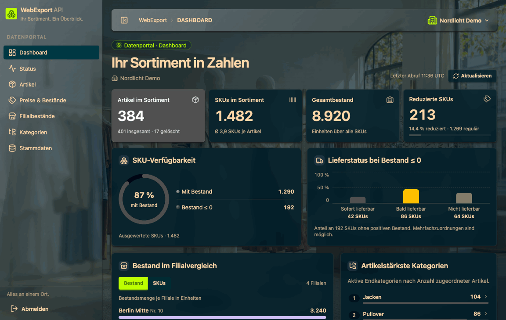

# WebExport

WebExport is a read-only product and stock portal for retail teams. Each company can browse its own products, check prices, and see what is in stock at each store.

**Frontend**

[](WebExport.Portal/)


**Backend**


[](WebExportAPI/)
[](WebExportAPI/src/Db/)

[](WebExportAPI.Tests/)



_A short tour of the German-language portal with sample data._

## What you can do

| Area                                 | What you can see and do                                                                                                                                                                 |
| ------------------------------------ | --------------------------------------------------------------------------------------------------------------------------------------------------------------------------------------- |
| 📊 **Dashboard**                     | See product and SKU counts, stock by store, top categories, recent product changes, and products with missing details.                                                                  |
| 📦 **Products and SKUs**             | Find products by number, category, or last update. Open product and variant details, including descriptions, attributes, image file info, materials, size charts, and related products. |
| 🏬 **Prices and stock**              | Check regular and sale prices, see what is available now or soon, and look up stock by SKU, product, or store.                                                                          |
| 🗂️ **Categories and reference data** | Browse the category tree, show active categories only, and look up colors, sizes, stores, delivery status, and attribute types.                                                         |
| 🔑 **Sign-in and status**            | Sign in to see your company details, check API and database health, and see how much time is left in your session. The portal keeps the color theme you pick at sign-in.                |

Product and stock lists use pages. Product-number and SKU filters match part of a code and ignore letter case. The catalog and price lists can also show deleted items.

## How it works

The portal calls ASP.NET Core Minimal APIs under `/api/v1`. Requests use an API key, and company data also requires a JWT from sign-in. The API limits login attempts, uses request IDs to trace calls, and sends an ETag so clients can reuse the color list. Both apps share request and response types. [Models](Models/)

<details>
<summary><strong>Run locally</strong></summary>

Install the **.NET 10 SDK** and **Node.js with npm**. Use a PostgreSQL database with the WebExport schema, an active company, and a registered API client.

Add your local settings in `WebExportAPI/appsettings.Development.json`.

```json
{
  "ConnectionStrings": {
    "DefaultConnection": "Host=localhost;Database=webexport;Username=YOUR_USER;Password=YOUR_PASSWORD"
  },
  "ApiKey": "YOUR_API_KEY",
  "Jwt": {
    "Key": "REPLACE_WITH_A_RANDOM_KEY_OF_AT_LEAST_32_BYTES",
    "Issuer": "WebExport",
    "Audience": "WebExport.Portal",
    "ExpiryMinutes": 60
  }
}
```

From the repo root, install the front-end packages and start the API.

```bash
npm ci --prefix WebExport.Portal
dotnet run --project WebExportAPI --launch-profile http
```

In a second terminal, start the portal.

```bash
dotnet run --project WebExport.Portal --launch-profile http
```

Open the [portal](http://localhost:4000) and sign in with your client ID, client secret, and API key. Use [Swagger UI](http://localhost:3000/swagger) to explore the API.

For the integration tests, set `ConnectionStrings:TestConnection` in the .NET user secrets for `WebExportAPI.Tests`. Point it to a separate PostgreSQL database named `webexport_automated_tests`, then run `dotnet test WebExportAPI.Tests/WebExportAPI.Tests.csproj`.

</details>
